============
NextContract
============

**NextContract** is contract lifecycle management for Odoo 19 Enterprise. It takes every contract from the first
request through legal review, drafting, negotiation, signature and activation, and then keeps track of it until it
is renewed, terminated or archived.

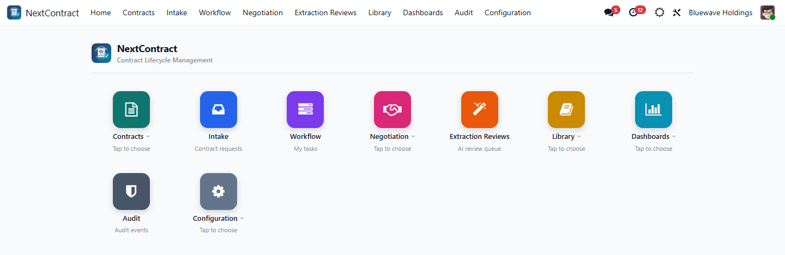

   The NextContract home screen. Each tile opens one area of the app.

With NextContract you can:

- collect contract requests from the business and screen them in Legal;
- keep approved templates, clauses and Word document templates in one library, and edit those Word templates
  inside Odoo;
- generate drafts in Word or PDF with the contract's data filled in;
- route reviews and approvals as tasks;
- negotiate with the counterparty through the Odoo portal, and compare versions;
- sign with Odoo Sign, or record a signature made on paper;
- track obligations, risk and key dates on live contracts, and renew, amend, terminate or archive them;
- report on all contracts and export them to Excel;
- optionally, extract contract data and compare clauses with Google Gemini.

.. contents:: On this page
   :local:
   :depth: 1

Quick start
===========

The first hour with NextContract, in order. Each step links to the details.

#. **Install** NextContract, its Python packages and LibreOffice (`Installation`_).
#. **Give people a role**: Legal, approvers, requesters and read-only users (`User roles`_).
#. **Check the defaults**: the contract types and the two approval rules are ready to use. Change them only if your
   process differs (`Contract types and fields`_, `Approval rules`_).
#. **Publish your first template**: upload your Word contract and add placeholders (`Step 3: Prepare the template`_).
#. **Run one contract end to end**, from request to activation (`Your first contract, step by step`_).

.. tip::
   Run your first contract with a colleague playing the requester and another the approver. That way every
   person sees their own part of the process.

Who does what
=============

.. list-table::
   :header-rows: 1
   :widths: 24 46 30

   * - Role
     - Typical work
     - Read
   * - Business Requester
     - Asks for new contracts and follows their progress
     - Step 1
   * - Legal Reviewer
     - Screens requests, drafts, reviews, negotiates, sends for signature and activates contracts
     - Steps 2 to 9
   * - Legal Admin
     - Everything Legal does, plus setup, templates, renewals, terminations and the audit trail
     - `Configuration`_, Steps 3 and 9
   * - Approver / Management
     - Approves or rejects the tasks assigned to them
     - Step 5
   * - Finance User / Procurement User
     - Gives input during review; Finance follows payments and other obligations
     - Steps 5 and 9
   * - Counterparty
     - Reviews the contract and uploads changes through the Odoo portal. Needs no Odoo licence.
     - Step 6

Requirements
============

.. list-table::
   :header-rows: 1
   :widths: 28 72

   * - Item
     - Requirement
   * - Odoo
     - Odoo **19.0 Enterprise** on your own server (or Docker). Not available on Odoo Online, which does not allow
       custom modules. Odoo.sh has not been verified yet.
   * - Odoo apps
     - Documents, Sign and Employees. Purchase only for linking contracts to purchase orders.
   * - Python packages
     - Listed in ``requirements.txt``: ``python-docx``, ``docxtpl``, ``xlsxwriter`` and ``pypdfium2``, plus
       ``google-genai`` and ``pydantic`` if you use the AI features.
   * - LibreOffice
     - On the Odoo server, to turn Word documents into PDF with their Word layout.
   * - Browser
     - A current version of Chrome or Edge.
   * - AI (optional)
     - Your own Google Gemini API key. Google bills its use.

Installation
============

#. Copy every folder of the NextContract package into a directory on your Odoo addons path. The Word editor is
   included in the ``clm`` module; no other module is needed.
#. Install the Python packages::

      pip install -r requirements.txt

#. Install LibreOffice on the Odoo server (Debian/Ubuntu)::

      apt-get install -y libreoffice-writer-nogui fonts-liberation fonts-dejavu-core

#. Restart Odoo.
#. Go to **Apps**, remove the *Apps* filter, search for **NextContract** and click **Activate**.

**Result:** the **NextContract** app appears on the Odoo home screen. Installing it installs the whole suite.

.. important::
   **Behind a reverse proxy** (nginx, Apache, a load balancer), the Word editor needs:

   - ``.wasm`` files served with the type ``application/wasm``;
   - same-origin framing allowed: ``X-Frame-Options: SAMEORIGIN``, not ``DENY``;
   - if you set a Content-Security-Policy, ``'wasm-unsafe-eval'`` allowed for scripts;
   - HTTPS. The copy button in the editor's Tags panel only works over HTTPS.

Configuration
=============

User roles
----------

#. Go to **Settings ‣ Users & Companies ‣ Users** and open the user.
#. On the **Access Rights** tab, choose a role in the **NextContract** field.

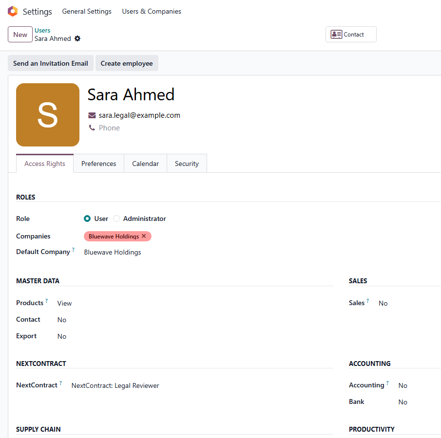

   Choose the user's NextContract role on the Access Rights tab.

.. list-table::
   :header-rows: 1
   :widths: 28 72

   * - Role
     - What the user can do
   * - Read-Only User
     - Read contracts that are not restricted. No changes, no approvals.
   * - Business Requester
     - Create and submit requests. See their own contracts, their department's, and contracts that are not
       restricted.
   * - Procurement User
     - Requests, plus procurement and vendor contracts and their supporting documents.
   * - Finance User
     - Sees contract values, and manages obligations on the contracts they can see.
   * - Approver / Management
     - Approves, rejects or delegates the tasks assigned to them. Sees contract values and dashboards.
   * - Legal Reviewer
     - Screens requests, reviews and negotiates contracts, rates risk, prepares signature and activates contracts.
       Sees every contract of the company.
   * - Legal Admin
     - Everything above, plus configuration, templates (approve, publish, retire), renewals, terminations,
       archiving and the audit trail.

.. note::
   **Contract value** is visible only to Legal Admin, Legal Reviewer, Finance User and Approver / Management.
   **Risk rating** is visible only to Legal. Users only see contracts of the companies they are allowed to access.

Contract types and fields
-------------------------

**NextContract ‣ Configuration ‣ Contract Types** already lists the common types: NDA, Services Agreement, Supply
Agreement, Software/SaaS Agreement, Lease Agreement and more. Add your own as needed.

**NextContract ‣ Configuration ‣ Contract Fields** adds your own fields to contracts, such as Governing Law,
Limitation of Liability or Payment Milestones. A field can apply to all contract types or only to some. The values
are filled in on the contract's **Additional Fields** tab, and each field's code can be used as a placeholder in
your templates.

Approval rules
--------------

**NextContract ‣ Configuration ‣ Workflow Rules** decides which approval tasks are created, and when. Two rules
come ready to use:

- **Legal Review Approval**, created when a contract is submitted for review;
- **Management Approval per DOP**, created when the legal review is complete.

You can limit a rule to a contract type or a minimum value, make it optional, or assign it to the Legal Admin.
A contract moves on only when the required tasks of its current step are done.

Activation checklist
--------------------

**NextContract ‣ Configuration ‣ Activation Checklist** lists what must be filled in before a contract can go live:
counterparty, type, owners, currency, dates, notice period, confidentiality, risk rating, the signed copy and the
executed version. Switch off what your process does not need.

Notifications and alerts
------------------------

**NextContract ‣ Configuration ‣ Notifications** decides who is told about which contract events. When a contract
goes live, alerts are created for its key dates: expiry, renewal, notice period and others. They run on a schedule.
**NextContract ‣ Configuration ‣ Process Contract Alerts** runs them immediately.

AI features (optional)
----------------------

AI extraction sends contract content to **Google Gemini**. Nothing is sent until an administrator has set it up
and given consent for the company.

#. Go to **Settings ‣ NextContract AI Configuration**.
#. Tick **Enable AI Features**, enter the **Gemini API Key** and choose a **Gemini Model**.
#. Under **Cloud Processing Consent**, click **Acknowledge**. Odoo records who consented and when. **Revoke**
   withdraws consent at any time.
#. Optionally, adjust the **Review Thresholds**. Suggestions at or above the high threshold are pre-selected.
   Suggestions below the low threshold must be checked before the review can be confirmed.

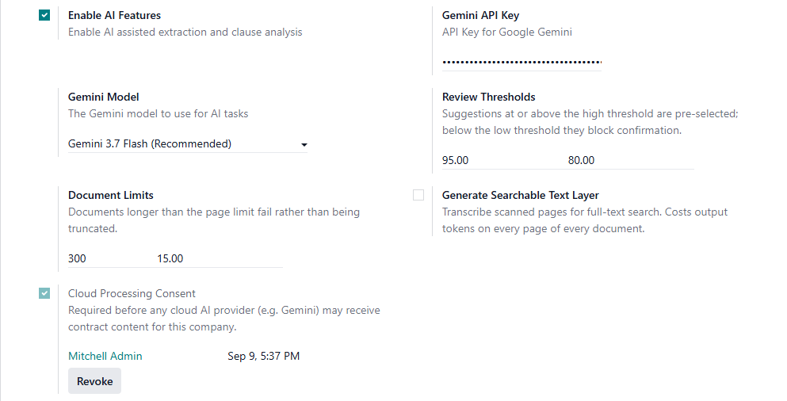

   AI settings. Consent is recorded per company, with the name of the person who gave it and the date.

.. warning::
   Make sure your organisation allows contract content to be processed by Google before you acknowledge.

Your first contract, step by step
=================================

A contract moves through these statuses. The status bar at the top of every contract shows where it is, and the
buttons next to it show what can be done now.

*Draft Request* → *Under Legal Review* → *Internal Review Completed* → *Under Negotiation* →
*Approved for Signature* → *Pending Signature* → *Executed* → *Active*

Step 1: Request a contract
--------------------------

**Who:** anyone with a NextContract role who needs a contract.

#. Go to **NextContract ‣ Intake ‣ Contract Requests** and click **New**.
#. Fill in what you know: title, counterparty (and who signs for them), contract type, department, purpose,
   estimated value, start date and urgency. Attach any supporting documents.
#. Click **Submit Request**.

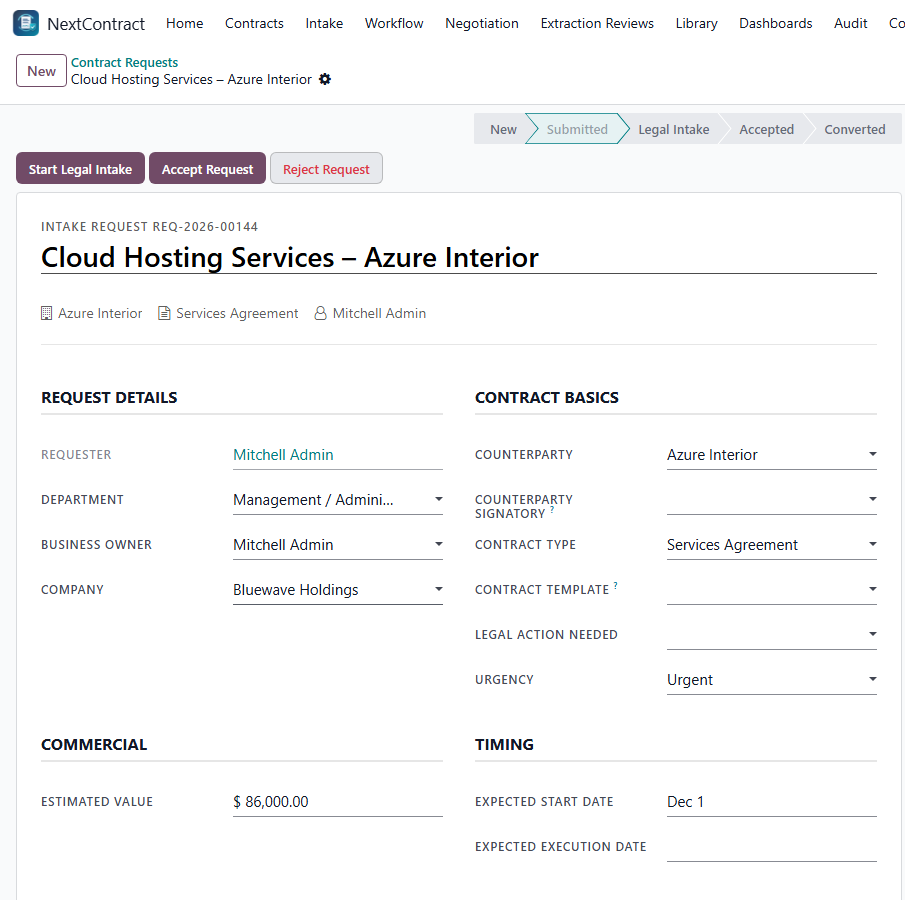

   A submitted request. The status bar shows where it is; Legal sees the buttons to screen it.

**Result:** the request gets a reference such as ``REQ-2026-00144``, and Legal sees it in the list of requests.

Step 2: Screen the request (Legal)
----------------------------------

**Who:** Legal Reviewer or Legal Admin.

#. Open the request and click **Start Legal Intake**.
#. Check the details and documents, then click **Accept Request**, or **Reject Request** with a reason.
#. On an accepted request, click **Convert to Contract**.

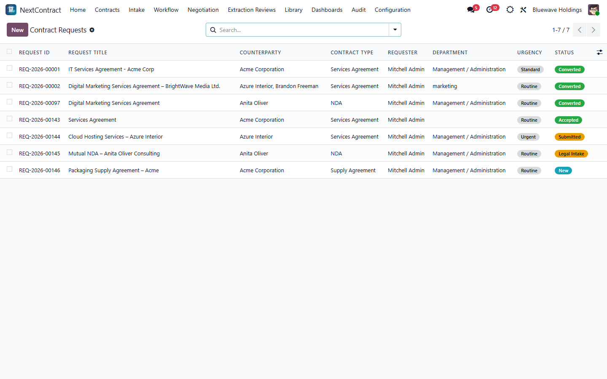

   All requests at a glance, with urgency and status.

**Result:** a contract is created with the request's details, with a reference such as ``CNT-2026-00771``. You can
also create contracts directly in **NextContract ‣ Contracts ‣ All Contracts**.

Step 3: Prepare the template
----------------------------

**Who:** Legal Admin. Do this once per type of contract; every contract of that type then reuses it.

Templates and clauses live in **NextContract ‣ Library**. **Clauses** hold your standard wording. A **template**
combines a contract type, its clauses and a **Document Template**: the Word file used to produce contracts.

#. Go to **NextContract ‣ Library ‣ Templates**, click **New**, and give the template a name and contract type.
#. On the **Document Template** tab, click **Upload** and choose your ``.docx`` contract. The first file is kept as
   the original and is never overwritten.
#. Put placeholders where the contract's data should appear, for example ``{{ partner_name }}`` or
   ``{{ effective_date }}``. The **Placeholders** panel lists them all (see `Placeholder reference`_).
#. Click **Insert Clause Collection** to add the template's clauses, and **Insert signature block** for a signature
   section for both parties.
#. Click **Validate**, then **Save Changes**, or **Save as New Template Version**.
#. Click **Submit for Review**, then **Approve**, then **Publish**.

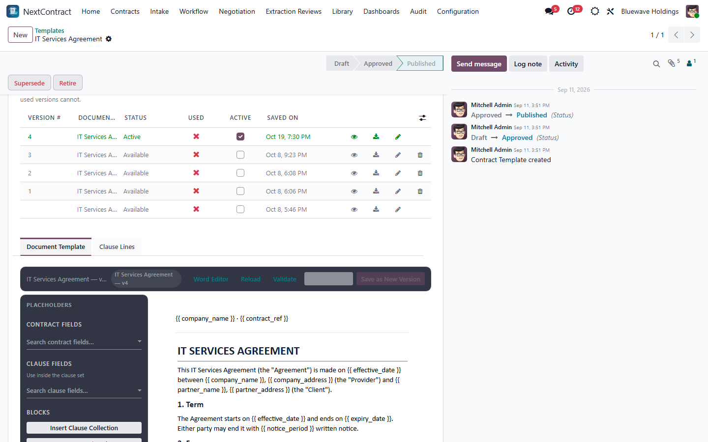

   The Document Template tab. The table lists the template's versions; the active one is used for new contracts.

To edit the Word file without leaving Odoo, click **Word Editor** on the **Document Template** tab.

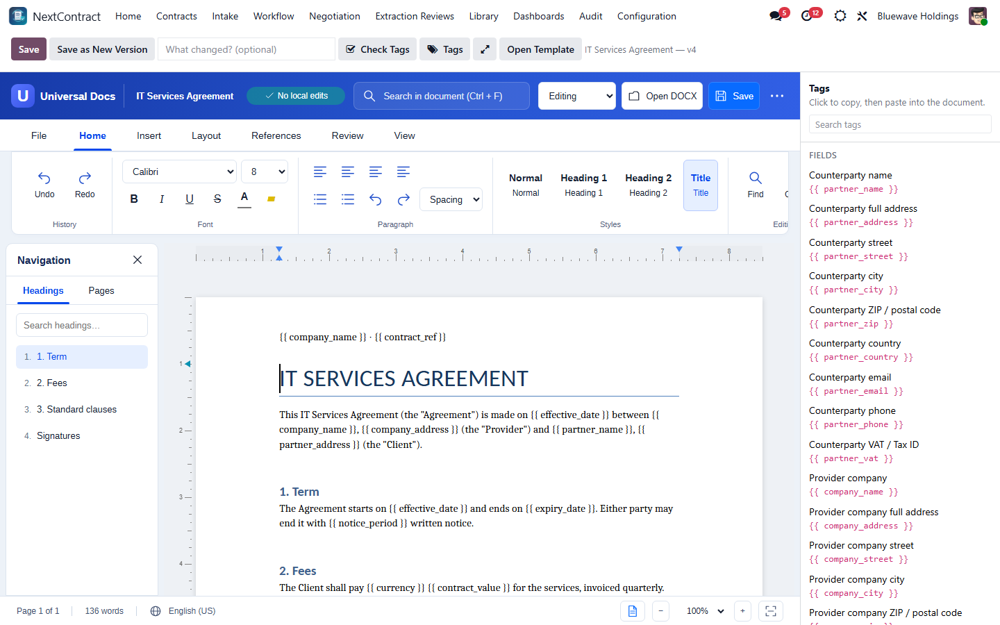

   The Word editor. Click a tag in the Tags panel on the right to copy it, then paste it into the document.

- **Save** (or Ctrl+S) saves onto the active version. If that version is the original, or a contract already
  uses it, a new version is created instead and you are told.
- **Save as New Version** always creates a new version and makes it active.
- **Check Tags** checks the placeholders without saving.
- If someone else saved the template after you opened it, your save is refused. Nothing is overwritten. Use
  **Download my copy** to keep your edits, or **Reload latest**.

**Result:** the template is *Published* and can be chosen on contracts. Contracts already drafted keep the version
they were drafted with.

Step 4: Draft the contract
--------------------------

**Who:** Legal.

#. Open the contract and choose a published **Contract Template**.
#. Click **Generate Draft** and choose Word (DOCX), PDF or a plain text preview.
#. Change the wording for this contract with **Edit Contract**. Keep a new version with **Create New Version**.
#. **Preview Contract**, **Generate DOCX** and **Generate PDF** produce the current version at any time.

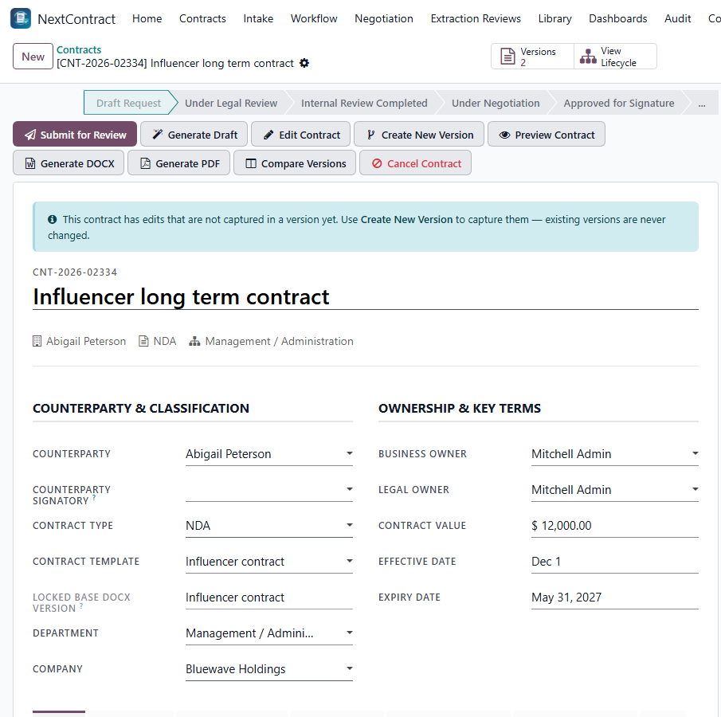

   A draft contract. The buttons show what can be done at this step.

**Result:** the draft is stored on the **Document Versions** tab, and in **NextContract ‣ Contracts ‣ Contract
Versions**. Each version has a type (Internal Draft, Counterparty Draft, Signature Draft and so on).
**Activate Version** makes a version the working one.

Step 5: Review and approve
--------------------------

**Who:** Legal, the approvers, and Finance, Procurement or Compliance when Legal asks for their input.

#. On the contract, click **Submit for Review**. The **Legal Review Approval** task appears on the
   **Workflow Tasks** tab.
#. If needed, ask other teams with **Request Business Input**, **Request Finance Input**,
   **Request Procurement Input** or **Request Compliance Review**.
#. When the legal review is done, click **Complete Internal Review**. This creates the management approval task.

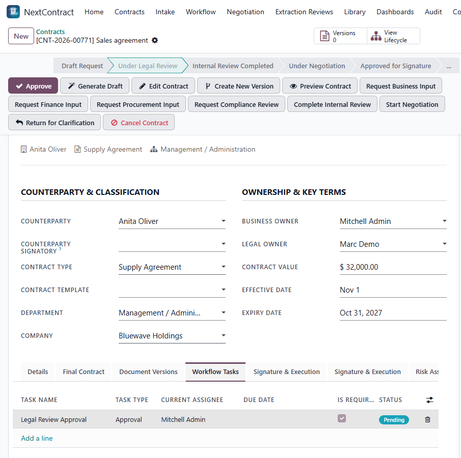

   A contract under legal review. Its tasks are on the Workflow Tasks tab.

Approvers do not need to search for contracts. Their tasks wait in **NextContract ‣ Workflow ‣ My Tasks**, where
they click **Approve**, **Reject** or **Delegate**.

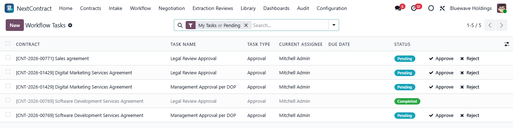

   My Tasks: every review and approval waiting for you, with Approve and Reject on each line.

**Result:** when the management approval is given, the contract is *Approved for Signature*. To send it back,
use **Return for Clarification**; to stop it, **Cancel Contract**.

Step 6: Negotiate with the counterparty
---------------------------------------

**Who:** Legal. The counterparty uses the Odoo portal; they need no Odoo licence.

.. important::
   **Give the counterparty's contact portal access first.** In **Contacts**, open the contact, then use
   **Action ‣ Grant portal access**. A counterparty who is given portal access only after the contract is sent does
   not see the contract.

#. On the contract (or on one of its draft versions), click **Send to Counterparty**. Check the version and the
   counterparty, add a response deadline and a note, then click **Send for Negotiation**.
#. The counterparty signs in to the portal and opens **Your Contracts**. They can read and download the shared
   version, and upload a revised document with comments.
#. Each exchange is a negotiation round in **NextContract ‣ Negotiation ‣ Negotiation Rounds**.
#. On a version, **Compare Versions** or **Compare with previous** shows a redline of the changes. Comparisons are
   kept in **NextContract ‣ Negotiation ‣ Version Comparisons**.

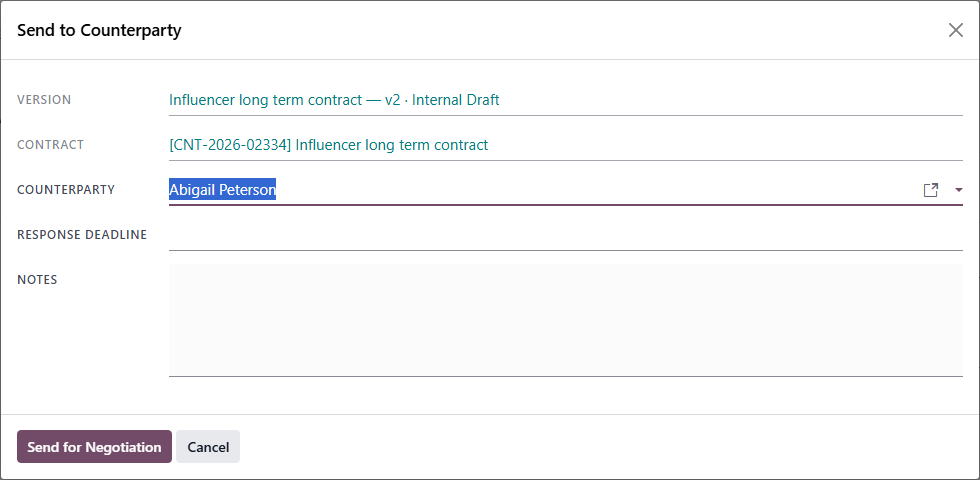

   Sending a version to the counterparty, with a response deadline and a note.

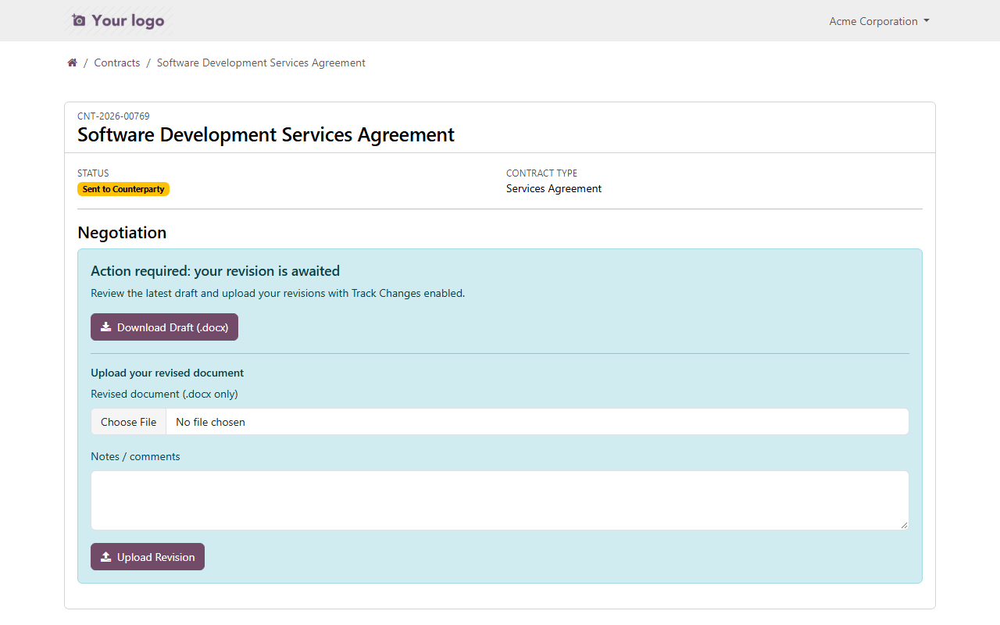

   What the counterparty sees in the portal: the shared version, and a form to upload their revision.

**Result:** the round is recorded with its deadline, and each revision is kept as a contract version.

Step 7: Sign
------------

**Who:** Legal sends; the signers sign with Odoo Sign.

#. Click **Prepare Signature Draft**. The final version becomes the *Signature Draft*. It must be active and have a
   document attached.
#. Click **Send for Signature**. Every signer needs a valid email address.
#. Follow progress on the **Signature & Execution** tab.

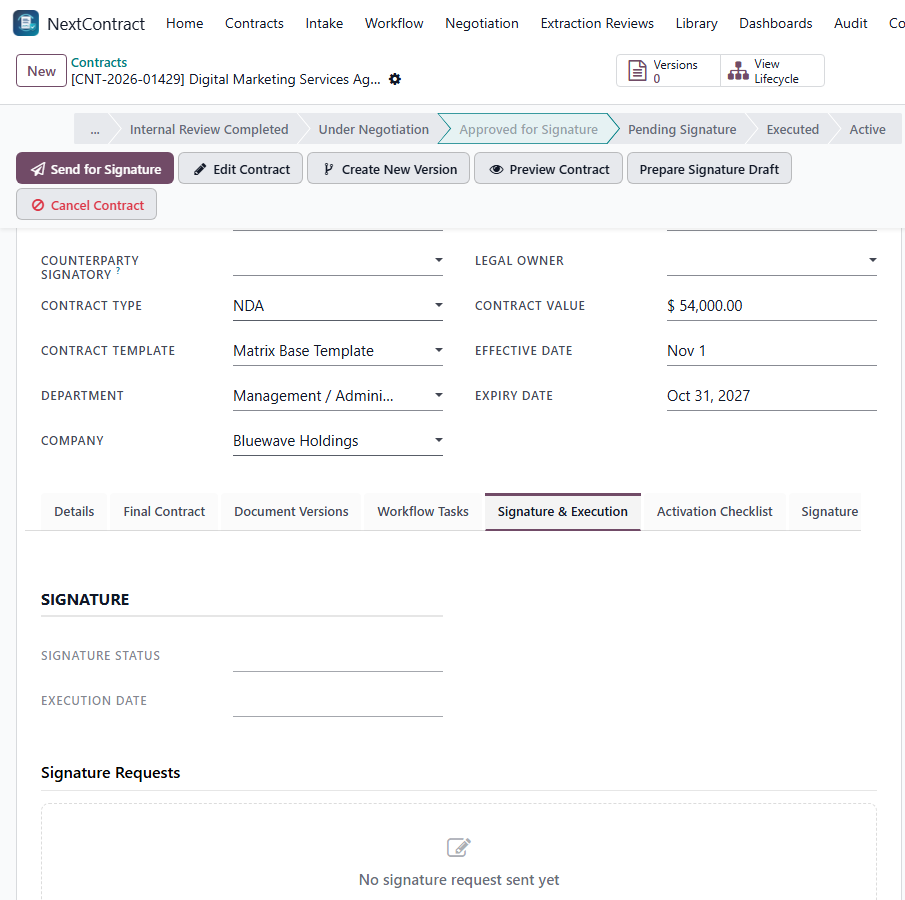

   An approved contract: Send for Signature routes it to Odoo Sign.

If the contract was signed on paper or outside Odoo, click **Mark as Manually Signed** instead. Upload the signed
PDF, enter the signing date and signatory, and confirm that the document is fully executed.

**Result:** when everyone has signed, the contract is *Executed*. The **Final Contract** tab has the signed contract,
with **Download PDF** and **Download DOCX**.

Step 8: Activate
----------------

**Who:** Legal.

#. Open the **Activation Checklist** tab and fill in anything still missing, usually the effective, expiry and
   signing dates.
#. Click **Activate Contract**.

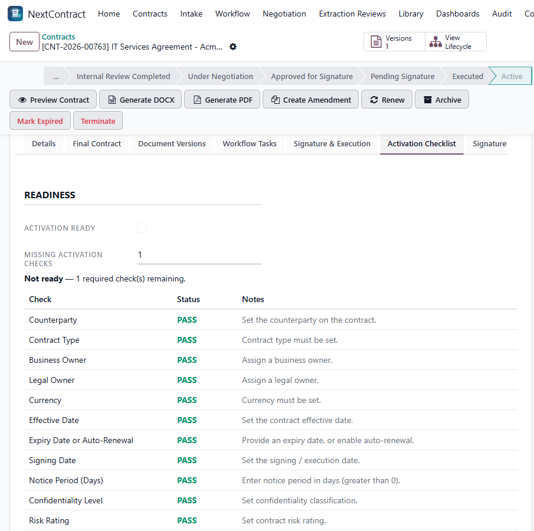

   The Activation Checklist shows what is still missing before the contract can go live.

**Result:** the contract is *Active*, and alerts for its key dates are created.

Step 9: Manage the live contract
--------------------------------

**Who:** Legal, Finance and the contract's owners.

- **Obligations**: payments, deliverables, SLAs, notices and renewals, each with an owner and a due date. Mark
  them **Complete** when done; overdue ones raise alerts.
- **Risk Assessment**: add risk factors and click **Recalculate Risk** to update the score and rating.
- **Alerts**: expiry, renewal, notice period, bank guarantee, insurance and other dates.
- **Create Amendment** starts a change to a signed contract. It goes through review and signature again; the signed
  version stays locked.
- **Renew** creates the renewed contract (recommended) or renews this one in place, with new dates and terms.
- **Terminate** records the date and reason and stops the alerts. **Mark Expired** and **Archive** close the
  contract.

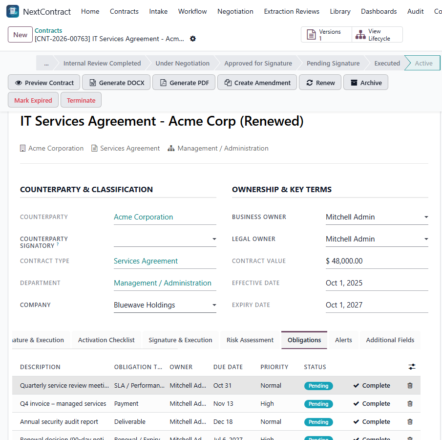

   Obligations on an active contract, each with its type, owner, due date and priority.

Click **View Lifecycle** on any contract to see its whole journey: which steps are done, skipped, current or to
come, who it is waiting on, and the overall progress.

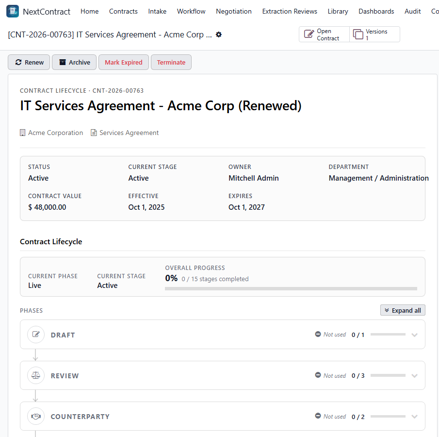

   The lifecycle overview of an active contract.

More features
=============

Reports and Excel export
------------------------

**NextContract ‣ Dashboards** has the **Contract Portfolio**, **Expiry & Renewal**, **Risk Analysis** and
**Obligation Analysis** reports, as graphs, pivot tables or lists. **Export Excel** exports contracts, requests,
obligations or workflow tasks, filtered by status, dates, contract type or counterparty.

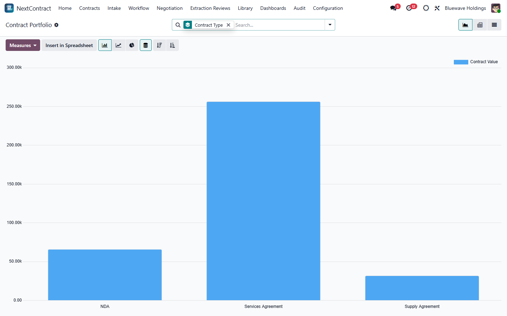

   Contract Portfolio: the value of your contracts by contract type.

AI extraction and clause review
-------------------------------

Requires the `AI features (optional)`_ to be set up.

#. On a contract version, click **Extract via AI**. Choose **Field Extraction**, **Clause Analysis** or
   **Full Analysis (Fields + Clauses)**.
#. The job runs in the background. Reviewers find it in **NextContract ‣ Extraction Reviews**.
#. Check the suggested values on the **Needs Attention** and **Review** tabs. Each one shows the source text it came
   from. Click **Confirm & Apply** to write the accepted values to the contract, or **Reject Extraction** to discard
   them.

Clauses that differ from your library are listed with their risk level.

Purchase orders
---------------

With *NextContract Purchase* installed, the contract's **Purchase Orders** tab lists its purchase orders, and each
purchase order shows its contract.

Import existing contracts
-------------------------

Legal Admins can bring existing contracts in through **NextContract ‣ Configuration ‣ Migration ‣ Migration
Batches**.

#. Prepare a ZIP file with ``contracts.csv`` (or ``contracts.xlsx``) and the contract PDFs. The columns are:
   *Vendor Name*, *Contract Title*, *Contract Number*, *Effective Date*, *Expiry Date*, *Execution Date*,
   *Contract Value*, *Legacy Source Reference* and *Document Path* (the PDF's path inside the ZIP).
#. Create a batch, upload the ZIP and click **Parse File**.
#. Click **Run Deduplication & Validation** and check the **Staging Records**.
#. Click **Import Valid Records**. Optionally, click **Run AI Extraction**.

The ZIP may be up to 200 MB, or 1 GB once unpacked, with at most 2,000 files. Only PDF documents are accepted.

Frequently asked questions
==========================

**Can we use the Word contracts we already have?**
   Yes. Upload each one as a template's Document Template and replace the variable parts with placeholders.

**What happens to signed or drafted contracts when a template changes?**
   Nothing. A contract keeps the template version it was drafted with. Only new contracts use the new version.

**Can the counterparty change our document?**
   They upload a revised version through the portal. You compare it with yours and decide what to accept.

**Do we have to use Odoo Sign?**
   No. The Sign app must be installed, but you can sign on paper and use **Mark as Manually Signed**.

**Who can see contract values?**
   Legal, Finance and Approvers. Requesters, Procurement and read-only users do not.

**How are we reminded about renewals?**
   When a contract goes live, alerts are created for its expiry, renewal and notice dates. You can also add your own
   obligations with due dates.

**Can we change the approval steps?**
   Yes, in **NextContract ‣ Configuration ‣ Workflow Rules** (see `Approval rules`_).

**Is the AI required?**
   No. Everything works without it. Nothing is sent to Google unless an administrator turns it on and consents.

Placeholder reference
=====================

Write placeholders with double braces in a Document Template, for example ``{{ contract_ref }}``. The codes of your
contract fields work the same way.

.. list-table::
   :header-rows: 1
   :widths: 35 65

   * - Placeholder
     - Value
   * - ``partner_name``, ``partner_address``, ``partner_street``, ``partner_city``, ``partner_zip``,
       ``partner_country``, ``partner_email``, ``partner_phone``, ``partner_vat``
     - Counterparty details
   * - ``company_name``, ``company_address``, ``company_street``, ``company_city``, ``company_zip``,
       ``company_country``, ``company_email``, ``company_phone``, ``company_vat``
     - Your company's details
   * - ``contract_name``, ``contract_ref``, ``contract_type``
     - Contract title, reference and type
   * - ``effective_date``, ``expiry_date``, ``signing_date``, ``renewal_date``, ``today``
     - Dates (``today`` is the date the document is produced)
   * - ``notice_period_days``, ``notice_period``
     - Notice period as a number of days, or as text (for example *30 days*)
   * - ``contract_value``, ``currency``
     - Value and currency. The value is filled in only for people allowed to see it.
   * - ``auto_renewal``, ``termination_for_convenience``
     - *Yes* or *No*
   * - ``business_owner``, ``legal_owner``, ``procurement_owner``, ``finance_owner``, ``department``
     - Owners and department
   * - ``risk_level``, ``risk_rating``, ``confidentiality_level``
     - Risk and classification
   * - ``company_signatory``, ``company_signatory_title``, ``company_signature_label``
     - Your signatory's name and job title, and your party label
   * - ``partner_signatory``, ``partner_signatory_title``, ``partner_signature_label``
     - The counterparty's signatory name and job title, and their party label
   * - ``template_name``, ``template_version``
     - The template used

Clauses are inserted with a loop, which **Insert Clause Collection** writes for you::

   
   
   {{ clause.title }}
   {{ clause.content }}
   
   

Inside the loop you can also use ``clause.category``, ``clause.description``, ``clause.risk_level``,
``clause.editability``, ``clause.required``, ``clause.is_locked``, ``clause.is_restricted`` and
``section.title``.

Contract statuses
=================

.. list-table::
   :header-rows: 1
   :widths: 32 68

   * - Status
     - Meaning
   * - Draft Request
     - Created, not yet submitted for review
   * - Under Legal Review
     - Legal is reviewing. The contract may wait on *Business*, *Finance*, *Procurement* or *Compliance* input.
   * - Internal Review Completed
     - Legal review done; waiting for management approval or negotiation
   * - Sent to Counterparty / Under Negotiation
     - Shared with the counterparty through the portal
   * - Approved for Signature
     - Approved; ready to send for signature
   * - Pending Signature
     - Out for signature with Odoo Sign
   * - Executed
     - Signed by everyone; not yet live
   * - Active / Expiring Soon
     - Live, and followed by alerts and obligations
   * - Renewed / Expired / Terminated / Archived / Cancelled
     - Closed

Upgrading
=========

#. Back up the database and the filestore.
#. Download the new version from your Odoo Apps orders page.
#. Replace the NextContract folders with the new ones. Replace whole folders; do not merge them.
#. If the release notes mention new requirements, run ``pip install -r requirements.txt``.
#. Restart Odoo and upgrade the modules::

      odoo -c <your config> -d <database> -u clm --stop-after-init

   Then start Odoo normally. Or, in **Apps** with developer mode active, open **NextContract** and click
   **Upgrade**.

#. Ask users to refresh their browser once (Ctrl+F5).

Upgrading *NextContract* also upgrades the installed NextContract add-ons and the Word editor.

Troubleshooting
===============

.. list-table::
   :header-rows: 1
   :widths: 40 60

   * - Problem
     - Solution
   * - "requires LibreOffice on the Odoo server" when previewing or exporting a PDF
     - Install LibreOffice (see `Installation`_) and restart Odoo.
   * - The Word editor stays blank or does not start
     - Behind a reverse proxy: serve ``.wasm`` as ``application/wasm``, allow ``X-Frame-Options: SAMEORIGIN`` and,
       with a Content-Security-Policy, ``'wasm-unsafe-eval'``. Use Chrome or Edge.
   * - The Word editor looks unchanged after an upgrade
     - Refresh the browser with Ctrl+F5.
   * - The **Word Editor** button is missing
     - It appears once the template has a Document Template. Upload a ``.docx`` on the **Document Template** tab.
   * - "Copy failed" in the Tags panel
     - Copying needs HTTPS. Select the placeholder text and copy it by hand.
   * - "Someone saved a newer Template Version"
     - Someone saved after you opened the editor. Use **Download my copy**, then **Reload latest**, and reapply your
       edits.
   * - The counterparty sees no contract in the portal
     - Their contact needs portal access *before* the contract is sent (see `Step 6: Negotiate with the
       counterparty`_). Send it again after granting access.
   * - "Cloud AI processing is not enabled"
     - Acknowledge cloud processing for the company (see `AI features (optional)`_).
   * - "Gemini API Key is not configured"
     - Enter the key in **Settings ‣ NextContract AI Configuration**.
   * - "Only approved contracts can be sent for signature" or "No active Signature Draft found"
     - Finish the approvals, then click **Prepare Signature Draft** before **Send for Signature**.
   * - "Complete the Activation Checklist first"
     - Open the **Activation Checklist** tab and fill in what is missing.
   * - A user cannot see a contract
     - Check their NextContract role and allowed companies. Restricted contracts are visible only to Legal and to the
       contract's owners.

Data and privacy
================

- Contracts, documents and their versions stay in your Odoo database and filestore.
- **AI features** send contract text and files to Google Gemini, with your API key, and only after an administrator
  has given consent for the company. Consent can be revoked at any time.
- **The Word editor** runs in the browser and saves to your Odoo server. Common fonts are included. Choosing a font
  that is not included may load it from Google Fonts, which receives the font name, not the document.
- **Counterparties** see only the contract versions shared with them through the portal.

Support
=======

Contact us from your order page on the Odoo Apps store. Please include your Odoo version, the NextContract version
(**Apps ‣ NextContract ‣ Module Info**), the steps that lead to the problem and any error message.

Release notes
=============

19.0.1.1.0
----------

- First release on the Odoo Apps store.
