# AI Prospecting Agents for LinkedIn — User Guide

**Odoo 18 · Community & Enterprise · Version 18.0.1.0.0 · Nextbridge**

---

## 1. Introduction

AI Prospecting Agents for LinkedIn brings LinkedIn prospecting into Odoo. AI agents write personal connection
invitations, hold the first conversation with new connections, follow up when people go quiet and draft LinkedIn
posts. Odoo decides how much is sent, when and how fast, and creates a CRM lead as soon as a prospect is ready to
talk to a salesperson.

The writing is done by **your AI assistant**, connected to Odoo through a secure **MCP connector** (Model Context
Protocol). Odoo never stores an AI API key.

### 1.1 Key concepts

| Term | Meaning |
|---|---|
| **LinkedIn Profile** | One LinkedIn account connected to Odoo, usually one per sales rep. |
| **Service** | Something you sell. The AI only describes your services as you wrote them. |
| **Persona** | One target audience (roles, regions, keywords) with its own invitation and conversation agents. |
| **Prospect** | One person on LinkedIn, tracked through stages from *Queued* to *Warm lead*. |
| **Sending queue** | Every invitation, message and post waits here before it is sent. |
| **Connector URL** | The secret address your AI assistant uses to work with Odoo. |
| **AI run** | One working session of the AI assistant (for example a scheduled morning run). |

### 1.2 Two connection options

| | Built-in engine | AI browser agent |
|---|---|---|
| LinkedIn actions performed by | An automation browser on your Odoo server | An AI browser extension in the rep's Chrome |
| Hosting | Self-hosted Odoo 18 on Linux | Any Odoo 18, including Odoo.sh |
| Availability | Continuous | While that computer is on |
| Pacing and safety rules | Applied by Odoo | Applied by Odoo; every send is approved by Odoo first |

You can use both options in the same database, one per LinkedIn account.

---

## 2. Requirements

- Odoo 18 Community or Enterprise. Required apps (installed automatically): CRM, Calendar, Discuss, Contacts,
  Sales Teams.
- An AI assistant that supports **custom remote MCP connectors** over HTTPS.
- Odoo reachable from the internet over **HTTPS**, so the AI assistant can call the connector URL.
- In production, run Odoo with workers (`workers = 2` or more, `max_cron_threads = 2`) so scheduled actions run.
  If the server hosts several databases, set `dbfilter` so each domain opens the right database.

**Built-in engine only**

- Linux server (x86_64 or arm64) with outbound internet access.
- About 1–1.5 GB of RAM for each LinkedIn account that is actively connected, and about 1.1 GB of disk, once, for
  the automation browser.
- Some operating-system libraries for the browser. If any are missing, Settings shows the exact install command.
- The connected LinkedIn accounts must use LinkedIn's interface in **English**.

**AI browser agent only**

- Google Chrome with an AI browser extension that can use MCP connectors, on the rep's computer.

---

## 3. Installation

1. Copy the `nb_linkedin_ai_prospecting` folder into your custom addons path (or purchase and install it from the
   Odoo Apps Store).
2. Restart Odoo.
3. Activate developer mode, open **Apps → Update Apps List**, search for *AI Prospecting Agents for LinkedIn* and
   click **Activate**.
4. A new **LinkedIn Sales** app appears in the main menu.

### 3.1 Access rights

| Group | Can do |
|---|---|
| **LinkedIn Sales / User: own LinkedIn accounts** | Work with their own LinkedIn accounts, personas and prospects. |
| **LinkedIn Sales / Manager** | See every account, configure Settings, create connector URLs, connect accounts, allow re-invitations. |

Set the groups under **Settings → Users & Companies → Users**. The administrator is a Manager by default.

---

## 4. First-time setup

### 4.1 Prepare the automation browser (built-in engine)

1. Open **LinkedIn Sales → Configuration → Settings**.
2. In **LinkedIn engine (own server)**, click **Prepare engine**. Odoo downloads the automation browser into its
   data folder. This takes a few minutes and runs in the background.
3. Click **Refresh status** until the status reads **Ready**.
4. If the status asks for an administrator command, have your server administrator run it once, then click
   **Refresh status** again.

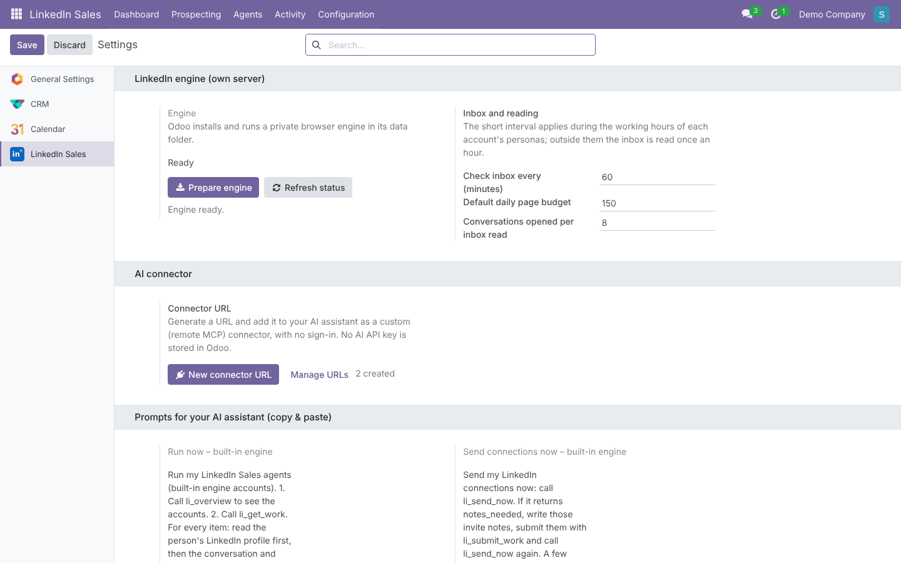

On Odoo.sh this block is replaced by a note that only the browser option is available.

### 4.2 Link your AI assistant

1. In Settings, **AI connector**, click **New connector URL**.
2. Give it a name and, if you want, limit it to some LinkedIn accounts. Click **Generate**.
3. Copy the URL. **It is shown only once.**
4. In your AI assistant, add a **custom (remote MCP) connector**, paste the URL and choose **no authentication /
   no sign-in**.
5. Make sure all of the connector's tools are enabled in your AI assistant.

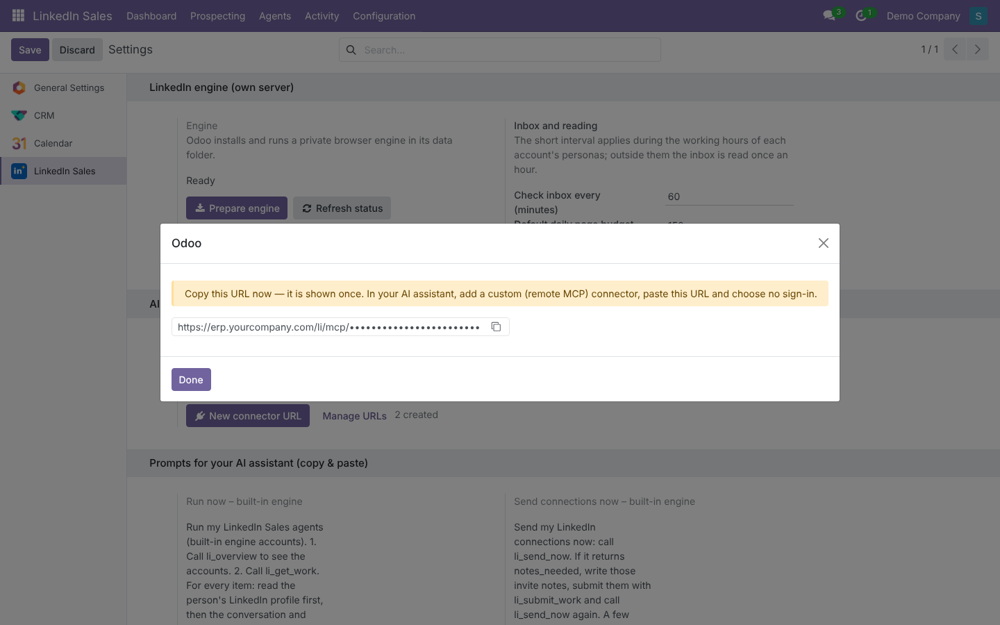

Manage URLs under **Configuration → Connector URLs**: see when each was last used, and **Revoke** a URL at any time.

### 4.3 Register LinkedIn accounts

Open **Agents → LinkedIn Profiles → New** and fill in:

- **Name**, for example "Sara — Sales".
- **LinkedIn URL**, the account's own profile address.
- **Owner**, the Odoo user who receives warm leads, reminders and reconnect requests.
- **Sales team** (optional), used on the CRM leads.
- **Execution mode**: *Built-in engine (own server)* or *AI browser agent*.

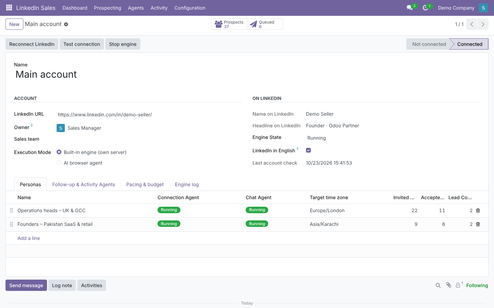

### 4.4 Connect a built-in engine account

Click **Connect LinkedIn** (or **Reconnect LinkedIn**) and choose a method:

- **Log in here**: LinkedIn's real sign-in page is displayed inside Odoo. Click into the picture and type as
  usual; two-step verification codes work and can be pasted. Click **I'm signed in — finish** when done.
- **Import session**: export your LinkedIn session from your usual computer (a `cookies.json` file, a zip that
  contains one, or a browser storage-state file) and upload it. Delete the exported file afterwards.
- **Paste cookie**: in Chrome on linkedin.com open *DevTools → Application → Cookies*, copy the value of `li_at`
  and paste it.

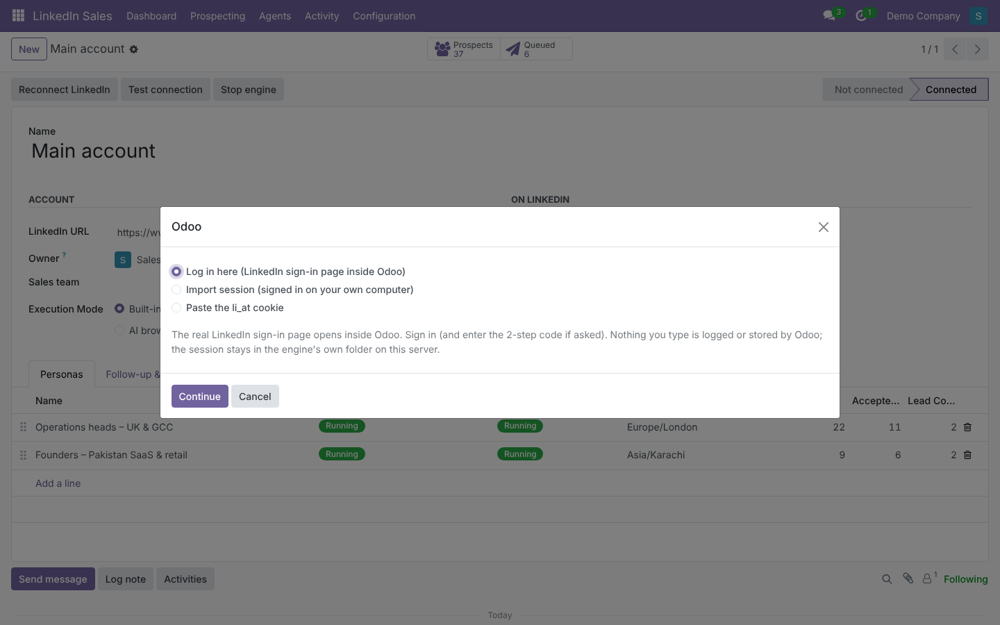

Then click **Test connection**. Odoo shows the account name it sees on LinkedIn and whether LinkedIn is in English.
If not, change the language in LinkedIn's settings and test again.

### 4.5 Set up an AI browser agent account

1. Create the LinkedIn Profile with execution mode **AI browser agent**.
2. On the rep's computer, use one Chrome profile per LinkedIn account. Sign in to LinkedIn there and install your
   AI browser extension with the Odoo connector enabled. Allow it to act on linkedin.com.
3. Copy the **AI browser agent** prompt from Settings, replace `PROFILE_ID` with the account's id (shown by the
   `li_overview` tool) and run it.

The agent first opens the account's own LinkedIn profile so Odoo can confirm it is the right account. It then
works through the tasks Odoo hands out, and asks Odoo for permission (`li_confirm_send`) right before every click
that sends, connects, follows, withdraws or posts.

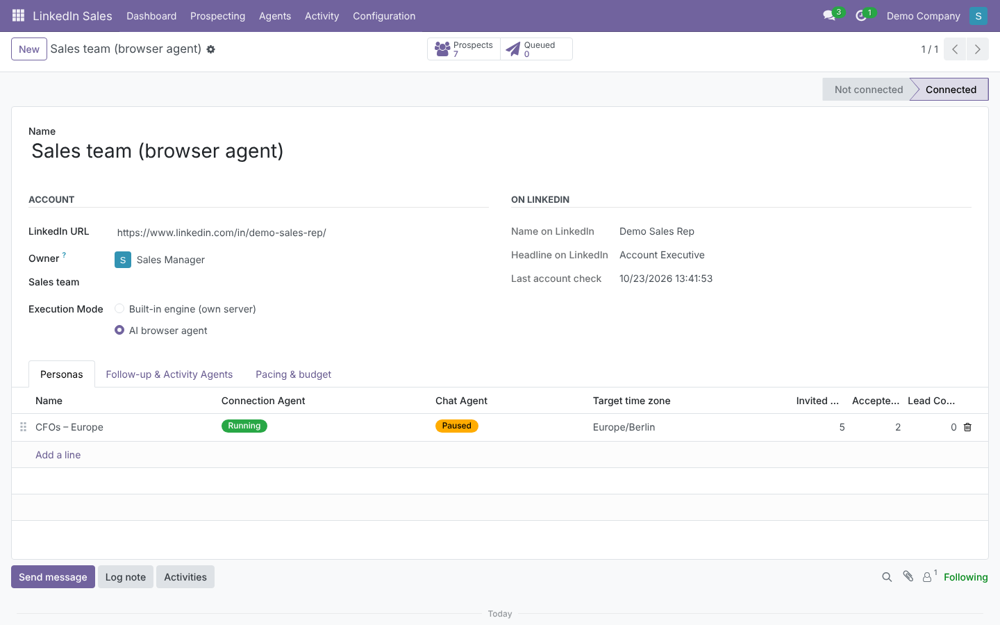

---

## 5. Configure what to sell and to whom

### 5.1 Services

**Configuration → Services**. For each offer, enter:

- **Description** and **value points** (one per line): the AI uses only these facts about your offer.
- **CRM tags** to put on leads created for this service.
- **Portfolio file** or **portfolio link**. A file gets a public link with a long random code. A new file gets a
  new link, and removing the file ends the link. PDFs and images open in the browser.
- **Contact phone** and **contact email**, shared only when a prospect asks for them.

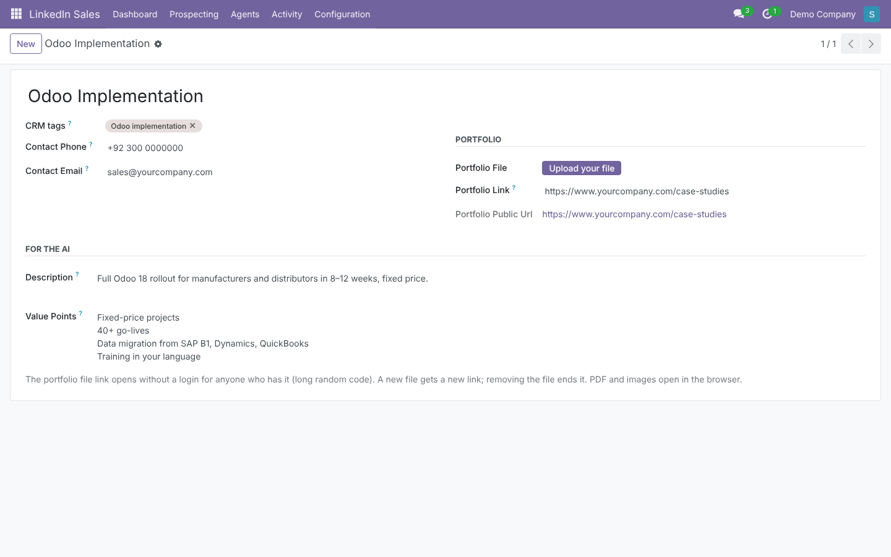

### 5.2 Personas

**Agents → Personas → New**. A persona is one target audience on one LinkedIn account.

| Field | Use |
|---|---|
| LinkedIn account, Services | Which account prospects from it, and what is offered |
| Target time zone, working days, send window | When actions may happen, in the prospect's local time |
| Random delay (s) | Minimum and maximum pause between two actions |
| Job titles, Locations | One per line; searches rotate through them |
| Keywords, Exclude keywords | Narrow the search; skip headlines containing excluded words |
| Industries, Ideal customer, Pain points | Context the AI uses to make messages relevant |

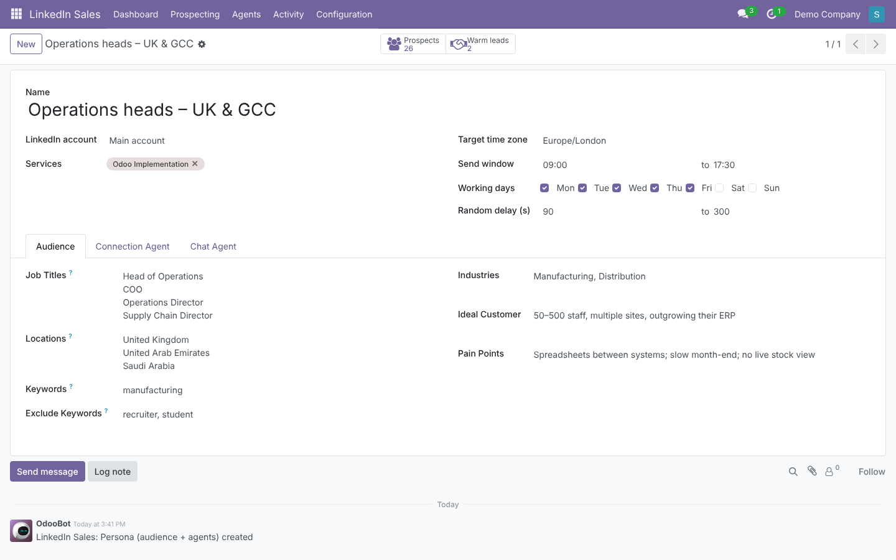

### 5.3 Invitation agent (Connection Agent tab)

| Setting | Meaning |
|---|---|
| Invites per day / per week | Caps for this persona (0 per week = no weekly cap) |
| Total target | Stop after this many invitations (0 = no target) |
| Find people automatically | Search LinkedIn for matching people when the queue runs low |
| Note with invite + Note instructions | Add a personal note (max ~300 characters) written by the AI |
| Follow when there is no Connect | Follow people who cannot be invited, instead of skipping them |
| Withdraw invites older than | Withdraw unanswered invitations after this many days (0 = never) |

Use **Run**, **Pause** and **Stop**. Stopping moves people not yet invited to *On hold*. Nobody is deleted, and
they return to the queue when you click **Run** again.

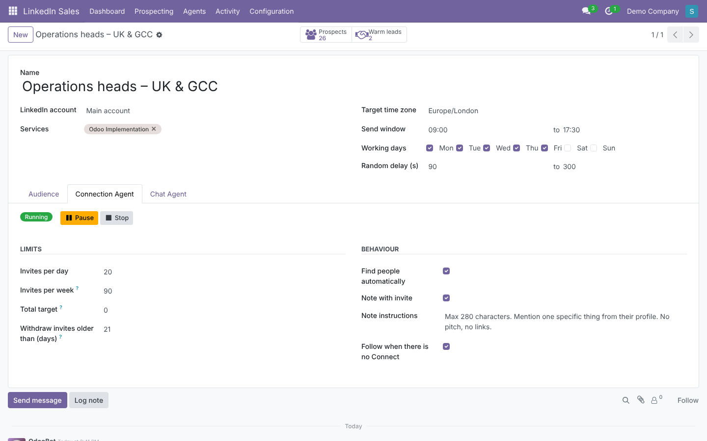

### 5.4 Conversation agent (Chat Agent tab)

- **Messages per day**, **tone** and **language**.
- **Questionnaire**: a short list of goals, each with a trigger (*after accept* or *after reply*), an optional wait
  in hours, instructions and an optional example. These are guidelines; the AI adapts every message to the person.
- **Pivot step** and **pivot criteria**: when the conversation reaches the pivot, the prospect is handed to sales.
- **Handoff message** and **meeting link**.

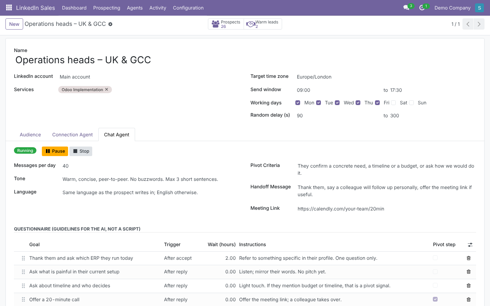

### 5.5 Follow-up and reminder agents

On each LinkedIn Profile, tab **Follow-up & Activity Agents**:

- **Follow-up Agent**: days of silence before a nudge, maximum number of nudges and instructions. After the last
  nudge, a silent prospect is closed as *No response*.
- **Activity Agent**: when a rep has taken over a prospect, every new reply creates a to-do for the owner with the
  chosen deadline. Overdue to-dos show red.

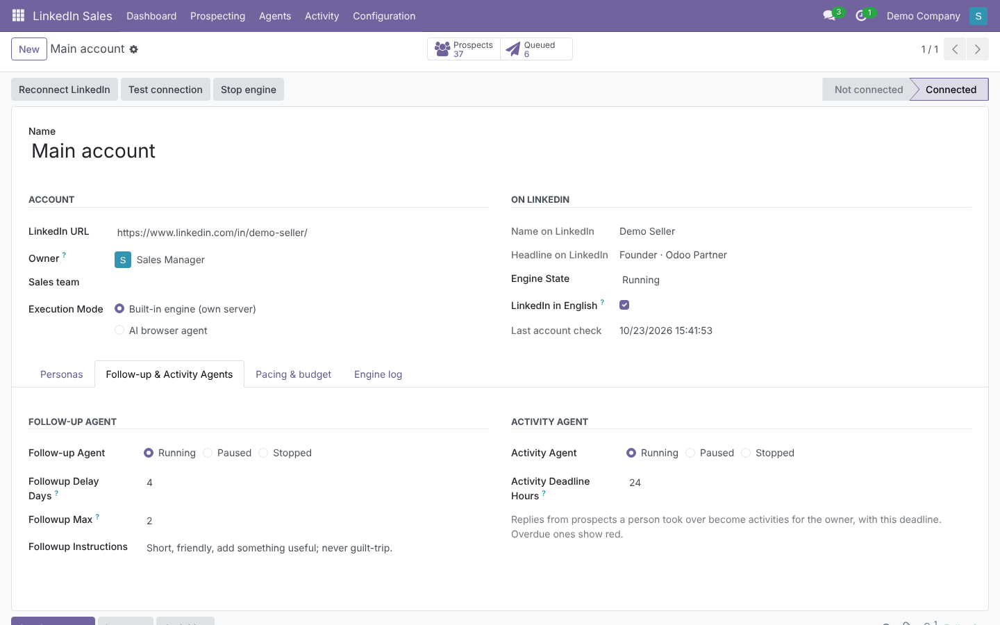

---

## 6. Daily use

### 6.1 How a day works (built-in engine)

1. Your AI assistant runs on a schedule, 1–3 times a day, using the *Scheduled* prompt from Settings. It writes
   invitation notes, first messages, answers to replies, follow-ups and post drafts.
2. Inside each persona's send window, Odoo sends the queued items one at a time with random pauses. It re-reads
   each conversation just before sending a message.
3. In the background Odoo reads the inbox, picks up accepted invitations, verifies sent invitations, reads new
   prospects' profiles and searches for more matching people.
4. When a prospect is ready, Odoo creates the CRM lead, schedules an activity for the owner, sends a short handoff
   message and stops the agents for that person.

### 6.2 Prompts

Settings contains ready-to-copy instructions:

| Prompt | Use |
|---|---|
| Run now – built-in engine | A full writing session |
| Send connections now | Write any missing notes and release queued invitations immediately (rules still apply) |
| Answer replies now | Read the inbox now and answer every new reply |
| Scheduled task | For a recurring task in your AI assistant, 1–3 times a day |
| AI browser agent | Run an AI browser agent session for one account |

You can also ask in plain language: *"Answer my LinkedIn replies"*, *"Invite linkedin.com/in/… from my account"*,
*"Did my invitations go out?"*, *"I'll handle Ali Raza myself"*.

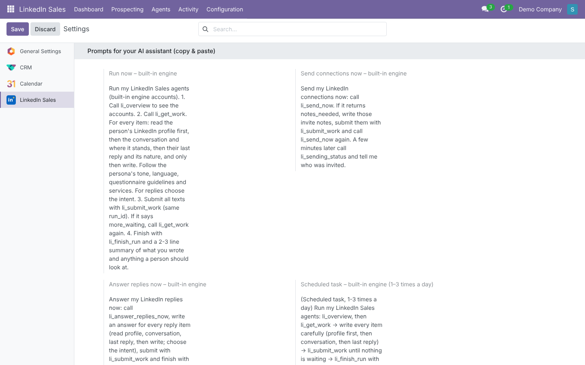

### 6.3 Prospects

**Prospecting → Prospects** shows the pipeline by stage. Useful filters: *Waiting for a reply*, *Needs a person to
check*, *Taken over*, *Warm leads*.

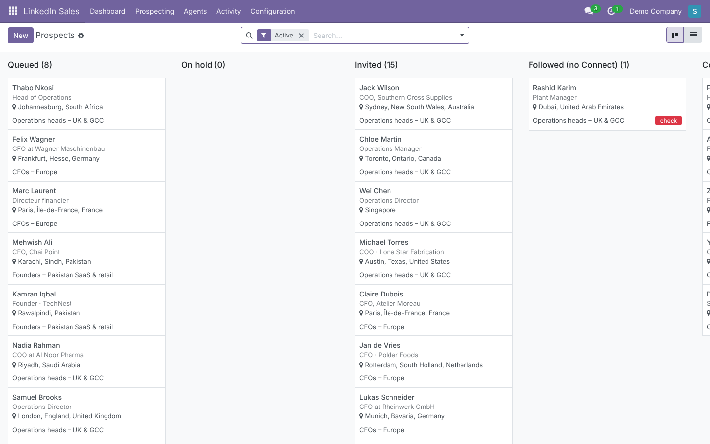

| Stage | Meaning |
|---|---|
| Queued / On hold | Waiting for an invitation / persona's invitation agent is stopped |
| Invited / Followed | Invitation sent / followed because LinkedIn offered no Connect |
| Connected / In conversation | Accepted / at least one message exchanged |
| Taken over | A person handles this prospect; agents are silent for them |
| Warm lead (CRM) | Handed to sales with a CRM lead |
| Closed: … | No response, not interested, withdrawn, declined or referred |
| Do not contact | Never contacted again from any persona |

Open a prospect to see the **Conversation**, the **AI summary** and answers, the **LinkedIn profile** kept in Odoo,
and the **Sending queue** for that person.

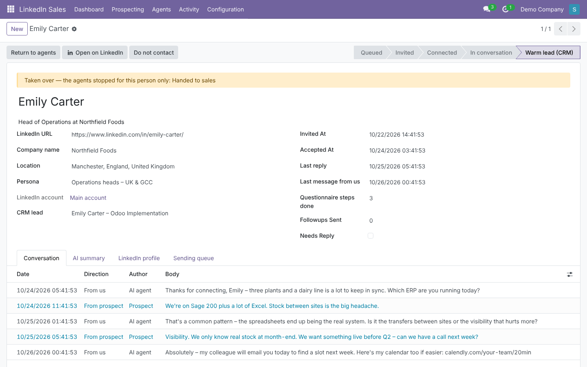

Buttons on the prospect:

- **Take over / Return to agents**: stop or resume the agents for this person only. Writing to the person yourself
  on LinkedIn also takes them over automatically.
- **Do not contact**: applies to every persona and account.
- **Allow invite again** (managers): for prospects who declined an invitation.
- **Checked**: clear a "needs a person to check" flag after you have verified LinkedIn yourself.

### 6.4 Warm leads in CRM

A CRM lead is created when the pivot step is reached, or when a prospect asks for a call, an email, a meeting or a
quote. The lead contains an instruction for the salesperson, the AI summary, the answers and the latest messages.
It also gets the service's CRM tags, the owner as salesperson and a to-do. Referrals ("talk to my colleague…")
create a lead with the referred person's details.

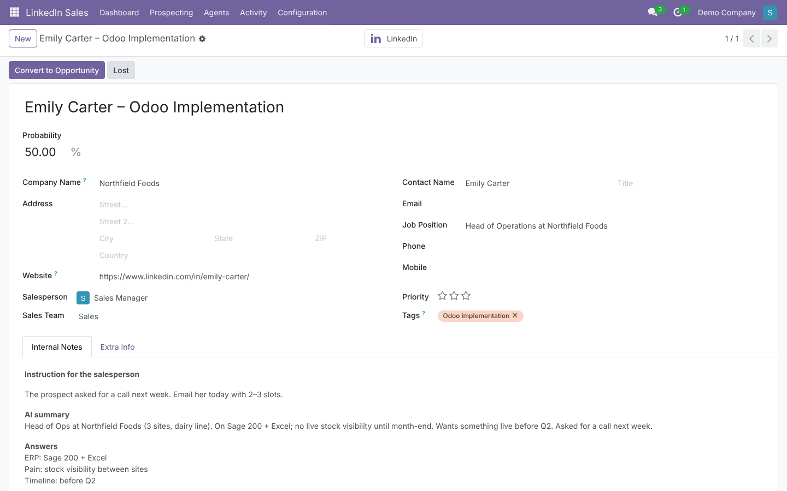

### 6.5 Sending queue

**Prospecting → Sending queue** lists everything waiting to go out. You can read or edit a text before it is sent,
**Drop** an item, **Retry** a failed one, or confirm with **I checked: it was sent** when an outcome was unknown.

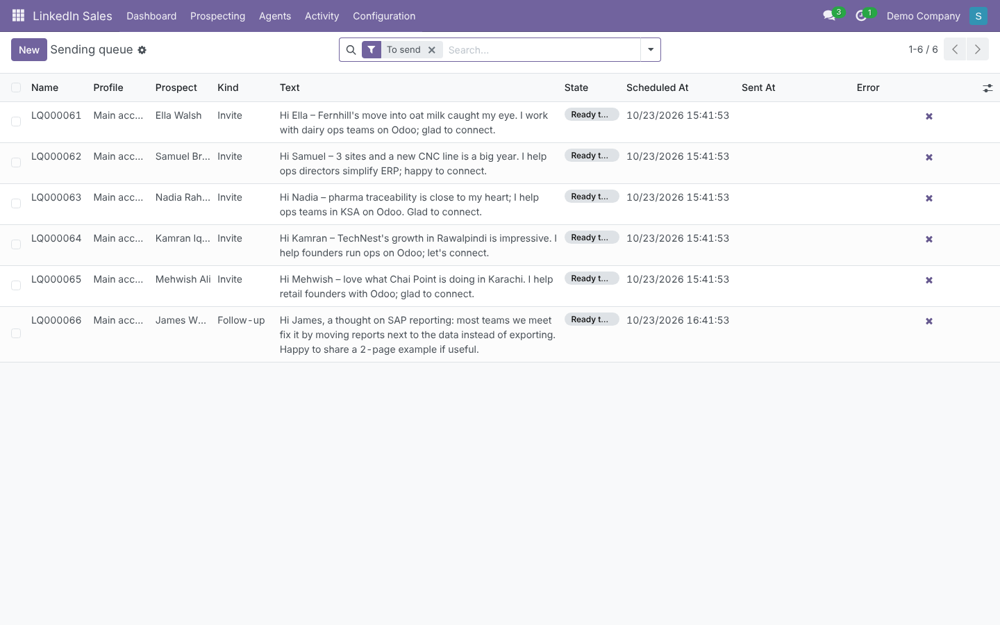

### 6.6 Posts

**Prospecting → Posts**: create a post with a title, account, optional service and an **idea**. The AI drafts the
text on its next run. Review and edit it, set **Publish at** and click **Approve & schedule**. After publishing, the
reactions, comments and comment texts are collected weekly. **Ask AI to redraft** sends a draft back to the AI.

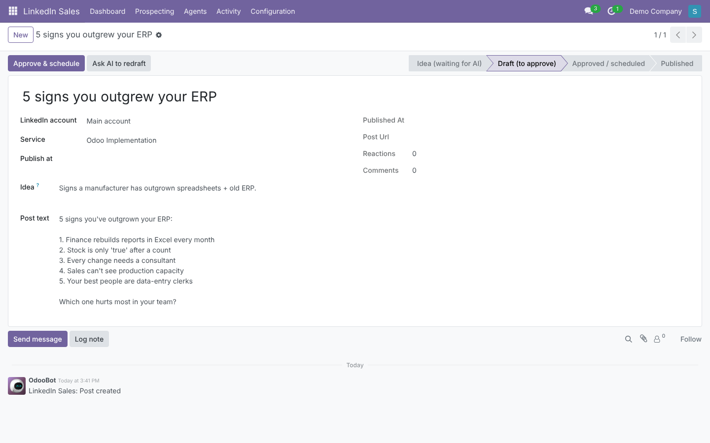

### 6.7 Dashboard

**LinkedIn Sales → Dashboard** shows KPIs (invitations, acceptance rate, reply rate, messages, warm leads, items
needing a person), account health, the work queue, the last AI run, invitations per day, the funnel, prospects by
stage, results per persona and a world map of prospects. Filter by account, persona and period. The page refreshes
every minute and the map works offline.

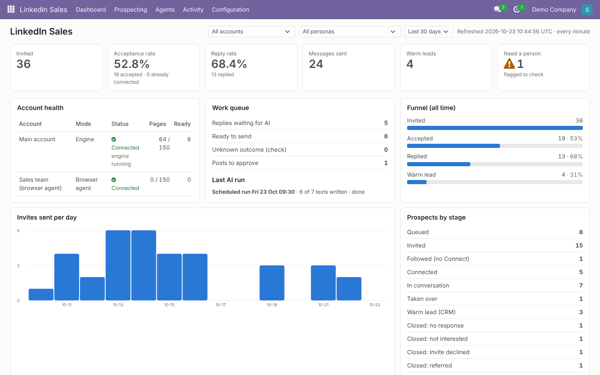

### 6.8 Activity logs

- **Activity → AI runs**: each AI session with the number of tasks given, texts written and texts refused, plus
  its summary and any errors.
- **Activity → Engine actions**: every automated LinkedIn action with its result and the number of pages read.
  Entries older than 60 days are removed automatically.

---

## 7. Safety rules applied by Odoo

The AI proposes texts; Odoo decides what is sent. These rules apply in both connection options:

- Daily, weekly and total caps per persona, and a daily message cap.
- Activity only on the persona's working days and inside its send window, in the prospect's time zone.
- Random pauses between actions, and never two actions at once on the same account.
- When LinkedIn reports its weekly invitation limit, invitations for that account pause until the next week. If
  two invitations in a row are silently not recorded, invitations pause for 24 hours. Both resume automatically.
- Each invitation is checked about 10 minutes later on LinkedIn's *Sent invitations* page, and if needed on the
  person's profile. Invitations that were never recorded go back to the queue. Declined invitations are never
  repeated unless a manager allows it.
- Before each message the conversation is read again. If the prospect wrote something new, the queued message is
  held back and the AI answers the new message instead.
- A text identical to one already sent to that person is refused.
- If it is unclear whether something was sent, it is never retried automatically; the prospect is flagged for a
  person to check.
- Taken-over and do-not-contact prospects are never contacted by the agents.
- Accounts signed out by LinkedIn ask for **Reconnect**. Restricted accounts are paused and their owner is
  notified.
- Each engine account reads at most the daily page budget (150 by default). Inbox and conversation reading may use
  up to 60% of it.

---

## 8. Settings reference

| Setting | Default | Meaning |
|---|---|---|
| Check inbox every (minutes) | 60 | Inbox interval during the personas' working hours; hourly outside them |
| Default daily page budget | 150 | Pages each new engine account may read per day (editable per account) |
| Conversations opened per inbox read | 8 | Maximum conversations opened at each inbox check |

Scheduled actions (**Settings → Technical → Scheduled Actions**, developer mode):

| Action | Interval |
|---|---|
| LinkedIn Sales: send | 2 minutes |
| LinkedIn Sales: read inbox, acceptances, profiles, search; verify sent invites | 5 minutes |
| LinkedIn Sales: plan invites, withdraw old invites, close silent prospects | 15 minutes |
| LinkedIn Sales: publish approved posts | 10 minutes |
| LinkedIn Sales: engine watchdog | 5 minutes |
| LinkedIn Sales: clean old engine logs | daily |

---

## 9. Troubleshooting

| Situation | What to do |
|---|---|
| Profile shows **Reconnect needed** | LinkedIn ended the session. Click **Reconnect LinkedIn** (or sign in again in Chrome), then run the agents. |
| Sign-in inside Odoo is refused or asks for extra checks | Use **Import session** or **Paste cookie**. |
| **Set LinkedIn to English** warning | Change LinkedIn's interface language to English, then **Test connection**. |
| Engine status not Ready / admin command shown | Have the administrator run the command shown, then **Refresh status**. |
| Engine stopped or did not start | Click **Start engine**. The watchdog also restarts engines every 5 minutes. The **Engine log** tab shows the last lines. |
| Invitations paused | LinkedIn's weekly limit was reached or invitations were not recorded. Wait for the automatic resume, or click **Resume invites** (managers). |
| Prospects went from Invited back to Queued | LinkedIn never recorded those invitations. They are invited again later. |
| Replies are picked up slowly | Lower *Check inbox every* and raise the page budget, or use *Answer replies now*. |
| AI says there is nothing to do | Normal when nobody accepted or replied since the last run. Odoo keeps working in the background. |
| AI does not see a tool after an update | Restart Odoo, upgrade the module, then refresh or re-add the connector in your AI assistant. |
| Scheduled actions do not run | Run Odoo with workers and cron threads. Check that the scheduled actions are active. |
| A prospect is flagged **Needs a person** | Check LinkedIn yourself, then click **Checked** (and **I checked: it was sent** on the queue item if relevant). |

---

## 10. FAQ

**Which AI assistant do I need?**
Any assistant that can add a custom remote MCP connector over HTTPS. You use your own AI subscription; Odoo stores
no AI API key.

**Can I review messages before they are sent?**
Yes. Everything waits in the Sending queue, where you can edit or drop it.

**Does it work on Odoo.sh?**
Yes, with the AI browser agent option. Odoo Online does not allow custom apps.

**Is my data shared with third parties?**
Prospect data stays in your Odoo database. The AI assistant only receives the context of the tasks it works on,
through your connector URL.

**Is using automation on LinkedIn allowed?**
LinkedIn's User Agreement restricts automated activity, and accounts can be limited or restricted. Keep caps
conservative, especially on new accounts. You are responsible for how you use LinkedIn.

---

## 11. Support

**Nextbridge** — installation, training and customisation.
Website: <https://www.nextbridge.pk>

*LinkedIn is a trademark of LinkedIn Corporation. This app is an independent product of Nextbridge and is not
affiliated with, endorsed or sponsored by LinkedIn. Map outlines: Natural Earth (public domain) via world-atlas
(ISC licence).*
